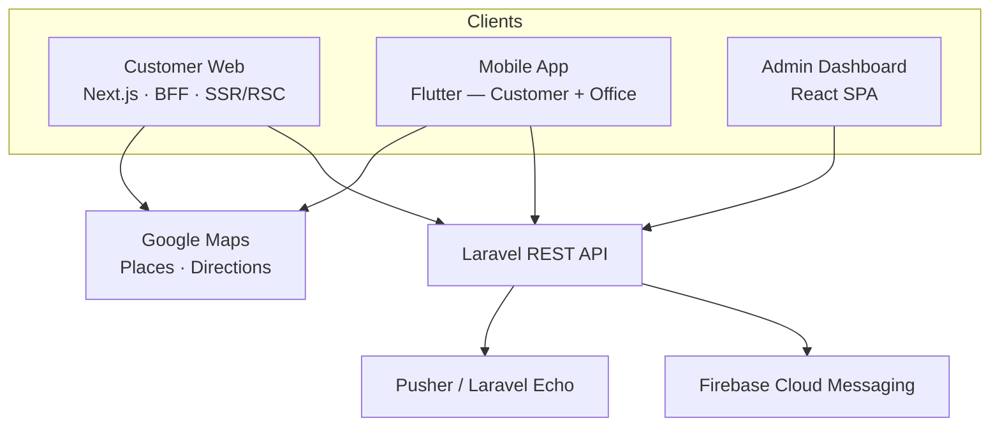

# Rento Car — Multi-Tenant Car Rental Platform

**Live:** [rentocar24.com](https://rentocar24.com/) · [App Store](https://apps.apple.com/de/app/rento-car-car-rental/id6760517523) · [Google Play](https://play.google.com/store/apps/details?id=com.rentocar.app)

Rento Car is a multi-tenant car rental platform connecting **customers and rental offices** through a unified ecosystem of applications sharing a common business domain and backend services.

The platform combines booking workflows, real-time vehicle availability, rental-office operations, geospatial delivery, financial settlements, and role-based access control into a single production system spanning **three client applications serving four distinct user-facing experiences**.

> Code is kept in private repositories due to client and business confidentiality. This documentation describes the system architecture, engineering decisions, and implementation considerations behind the platform.

---

## Product Ecosystem



| Application | Stack | Role |
|---|---|---|
| **[Customer Web](https://rentocar24.com/)** | Next.js App Router, React, TypeScript, BFF | Public-facing booking platform with server-side rendering and SEO support |
| **Mobile App** — [App Store](https://apps.apple.com/de/app/rento-car-car-rental/id6760517523) · [Google Play](https://play.google.com/store/apps/details?id=com.rentocar.app) | Flutter, Dart, BLoC/Cubit | Shared mobile application supporting both customer and rental-office workflows |
| **Admin Dashboard** | React SPA, Vite, Zustand | Platform administration, financial reporting, and operational control |
| **Backend** | Laravel, REST API | Shared backend services consumed by all three client applications |

Each client addresses a distinct operational boundary while consuming shared backend services — a **multi-client architecture built around a common business domain and backend**.

---

## Project Timeline & Market Deployment

Rento Car was developed over a **12-month period**, progressing from an experimental product version to a production release and commercial deployment.

### Development Milestones

| Phase | Duration | Outcome |
|---|---|---|
| Initial Development & Validation | First 8 months | Developed `v0`, an experimental version used to establish and validate the core product workflows and operational requirements. |
| Core Product Development & Launch | Following 4 months | Developed and launched the initial production version, establishing the foundation for real-world rental operations and customer bookings. |

### Commercial Deployment

The platform was launched with **8 contracted rental companies and offices across 5 cities**, including **2 companies specializing in airport taxi and transfer services**.

This marked the transition from product development to commercial deployment, supporting multiple operators across different locations and transportation service models.

Key milestones:

- **12 months of development**, from experimental validation to production launch.
- **8 contracted rental companies and offices** across **5 cities**.
- **2 airport transportation specialists** within the partner network.
- **Production launch** across web and mobile channels, supported by shared backend services and centralized administration.

The project combined iterative product development, cross-platform engineering, operational workflow design, and commercial onboarding to establish a foundation for continued product growth.

---

## Core Engineering Challenges

The primary engineering challenge was not building isolated interfaces, but coordinating **three architecturally distinct client applications** around one consistent business domain.

Key challenges included:

- Multi-tenant rental-office operations with isolated data boundaries.
- Role-based access control across guest, customer, rental-office, and admin roles.
- Stateful booking and vehicle-availability workflows beyond simple CRUD operations.
- Geospatial delivery routing and office-zone management.
- Real-time order-state propagation across different client applications.
- Financial settlement and reconciliation between the platform and rental offices.
- Consistent authentication and authorization across web, mobile, and dashboard clients.
- Production deployment, observability, and long-term maintainability.

These challenges required coordinated decisions across application architecture, backend integration, business workflows, and operational requirements.

---

## Deep-Dive Architecture Documentation

The following documents describe the architecture, security considerations, state management, and engineering trade-offs across the platform's client applications.

| Document | Scope |
|---|---|
| [Web Architecture](https://github.com/suliman-mousa/Rento-Car/blob/main/Web-architecture.md) | Next.js architecture, Backend-for-Frontend (BFF), session management, secure API proxying, authentication flows, and SSR/RSC data access. |
| [Mobile Architecture](https://github.com/suliman-mousa/Rento-Car/blob/main/mobile-architecture.md) | Flutter architecture, customer and rental-office modules, state management, dependency injection, secure storage, and notifications. |
| [Dashboard Architecture](https://github.com/suliman-mousa/Rento-Car/blob/main/dashboard-architecture.md) | React application structure, authentication, state management, real-time notifications, and internationalization/RTL support. |

Each document focuses on the architectural decisions and implementation trade-offs relevant to its respective application.

---

## Cross-Cutting Technology Stack

| Area | Technologies |
|---|---|
| **Web** | Next.js · React · TypeScript · Tailwind CSS |
| **Admin** | React · Vite · Zustand · React Router |
| **Mobile** | Flutter · Dart · BLoC · Cubit · GetIt (Dependency Injection) |
| **Backend** | Laravel · REST API |
| **Real-Time** | Laravel Echo · Pusher · Firebase Cloud Messaging |
| **Maps & Geospatial** | Google Maps Platform · Places · Directions |
| **Authentication & Security** | HttpOnly Cookies · Bearer Tokens · Encrypted Secure Storage · API Allowlisting |
| **Infrastructure** | Docker · Nginx · Linux · CI/CD |
| **Networking** | Axios · Dio with interceptor pipelines |

---

## Engineering Approach

Building Rento Car required working across the full software lifecycle for three client applications, from initial requirements through production deployment and ongoing improvement.

```text
Requirements
    → Domain Modeling
    → Architecture & Technical Planning
    → Implementation
    → Testing & Review
    → Deployment
    → Production Iteration
```

Responsibilities spanned architectural planning, technical decision-making, task decomposition, engineering coordination, code review, testing, release validation, and ongoing improvement — leading a team of up to **7 engineers** while remaining hands-on across the client applications.

A core engineering principle throughout the project was to **improve architectural consistency while preserving delivery velocity and production stability**.

Rather than treating architecture as a theoretical ideal, the project documentation captures implementation decisions and trade-offs in the context of an evolving production system.

---

## Project Links

- **Live Platform:** [rentocar24.com](https://rentocar24.com/)
- **iOS Application:** [Rento Car on the App Store](https://apps.apple.com/de/app/rento-car-car-rental/id6760517523)
- **Android Application:** [Rento Car on Google Play](https://play.google.com/store/apps/details?id=com.rentocar.app)
- **Web Architecture:** [Web-architecture.md](https://github.com/suliman-mousa/Rento-Car/blob/main/Web-architecture.md)
- **Mobile Architecture:** [mobile-architecture.md](https://github.com/suliman-mousa/Rento-Car/blob/main/mobile-architecture.md)
- **Dashboard Architecture:** [dashboard-architecture.md](https://github.com/suliman-mousa/Rento-Car/blob/main/dashboard-architecture.md)

*Source code remains private due to client and business confidentiality.*
